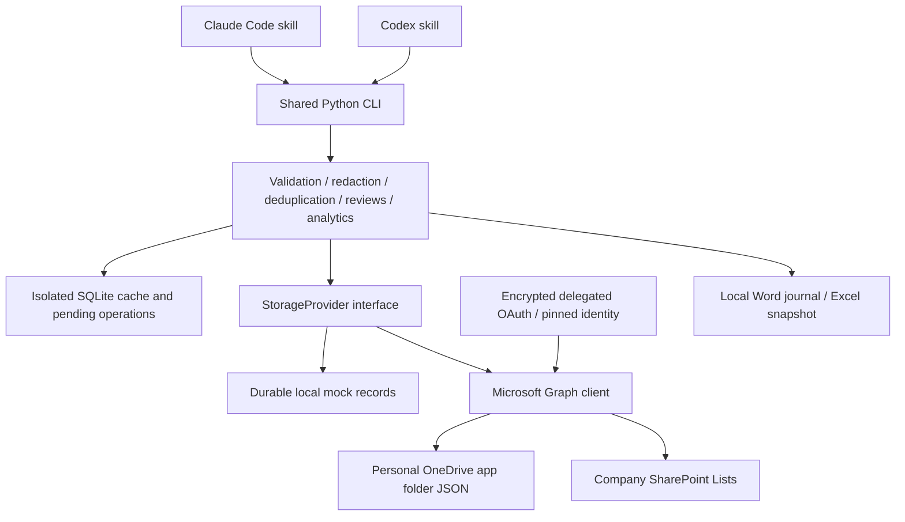

# Architecture and implementation plan

## Reference analysis

Inspected `swastij/claude-log-skill` revision
`2a2e2f84a4fd01ffe07e30413cc5607e220d16d2`: README, source, skill, and full tree.
It is an MIT-licensed Claude skill plus one standard-library Python Notion sender.
Tasks are upserted by tracker ID; decision/question titles are skipped if already
present. The skill drafts insights, asks approval, and adds recall questions for
confirmed shipped tasks. Its review workflow is manual with a 14-day interval.
There are no automated tests in that revision. It has no Microsoft, Codex,
offline index, or document-generation implementation. EKM is an original
implementation, preserving draft approval, lessons, alternatives, and recall.

Reference: https://github.com/swastij/claude-log-skill/tree/2a2e2f84a4fd01ffe07e30413cc5607e220d16d2

## Components

The agent extracts meaning from its available conversation; the CLI does not
pretend it can read either agent's private session API. Git context is read-only
metadata by default. The shared engine operates on one versioned Record schema
with seven kinds and stable UUID relationships. JSON is recoverable independently
of SQLite. Provider-specific IDs and ETags are not business identifiers.

## Roadmap and verification

1. Reference analysis and schema (`docs`, `models.py`), LOW: schema tests.
2. Profiles, encrypted OAuth, Graph (`config.py`, `microsoft`), HIGH: identity,
   origin, consent, retry, and failure tests.
3. Mock, OneDrive, SharePoint providers (`providers`), HIGH: CRUD, ETags,
   pagination, ambiguous failures, recoverable JSON tests.
4. Shared engine and CLI (`core`, `cli.py`), MED: isolation, approval,
   pending-save recovery, search, extraction and duplicate tests.
5. Decisions, investigations, debt, reviews and insights, MED: history-derived
   schedules, filters, similarity explanations and aggregate tests.
6. Word/Excel and GitHub metadata (`documents`, `integrations`), MED: safe
   output, formulas, no overwrite, Git metadata and optional gh tests.
7. Shared skill, installer, CI and setup docs, LOW: independently check both
   target paths and run all tests and lint. Runtime agent invocation and live
   Microsoft validation require separately configured accounts.

Suggested review boundaries are foundation/providers, knowledge workflows, and
reporting/agent integration. This personal greenfield repository is implemented
incrementally in one working tree; no production tenant operations are required.

## Failure model and pre-mortem

The largest risks are cross-account disclosure, lost updates after interrupted
sync, and mocks diverging from live Microsoft behavior. Profiles are pinned to
authenticated identity; no records migrate when switching profiles. Pending
operations are saved before remote writes, and remote records are reconciled by
UUID on retry. A stale ETag is a conflict, never an overwrite instruction.
Remote listings replace the cache only after a complete successful read. Reviews
are append-only histories, with question scheduling derived from histories so
there is no two-write transaction to partially commit.

Deletion intents and profile-local tombstones are persisted before remote deletion
to prevent queued drafts from resurrecting deleted records after local failure.
Names normalize to lowercase to preserve isolation on case-insensitive filesystems.
Reports project review history onto question statistics without rewriting questions.
Remote nonempty content hashes are verified to detect accidental payload corruption;
hashes provide integrity checks, not proof of a remote editor's identity.

OAuth persistence must fail closed if OS encryption is unavailable. Approvals
occur after redacted payload and destination previews; noninteractive explicit
`--approve` is suitable only after the agent obtained user authorization.
Offline work remains pending drafts until explicitly synced. SharePoint has
payload limits and unique indexed identity fields. Export creates new snapshots
and never overwrites unrelated workbooks. Live endpoints, permissions, app-folder
behavior, tenant policy and runtime skill invocation remain unverified until
separate smoke tests are performed with authorized test accounts.

## Personal OneDrive extension

`cli_microsoft.py` adds personal sign-in/storage commands over the existing engine.
MSAL owns browser PKCE, state validation and the localhost callback; encrypted
persistence and immutable account identity checks remain shared with the original
auth implementation. Public application settings load from an ignored `.env`.
No new company/SharePoint features are part of this phase.

New personal profiles explicitly consent to `User.Read Files.ReadWrite` for the
top-level `EngineeringKnowledge` folder. A root marker binds application ID,
hashed account identity and folder ID. Folder shortcuts are rejected for document
and record operations. Existing AppFolder profiles retain their paths and data.
Interrupted root creation without a marker requires explicit adoption approval.

`sync.py` stages downloads in SQLite against a fully enumerated ETag snapshot;
validated partial downloads survive interruptions, while the active index changes
only after the whole snapshot validates. Explicit conflict resolution checks the
current ETag and retains the prior local draft in a recovery table. A document
provenance ledger records EKM-created file IDs, ETags and byte hashes. Updates
require the tracked remote bytes/version to be unchanged; otherwise they fail
without replacing user-modified workbooks. There is no automatic Excel merge.
